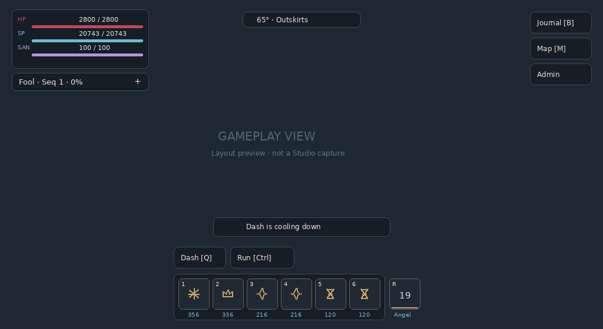

# HUD redesign

This revision addresses the crowded gameplay HUD in the supplied screenshot.

- Journal, Map and Admin use a single responsive menu rail. Map no longer uses a separate hardcoded position that collides with Admin.
- Vitals occupy a smaller panel with thin bars. The pathway summary defaults to a compact single line; detailed acting information remains expandable or accessible in the Journal.
- Six abilities and the ultimate are centered together. Smaller cards retain icons, key badges, costs and hover descriptions. The ornate card decorations are reduced to one accent edge.
- Cooldowns use a thin horizontal progress rule and a numeric timer. Movement controls sit above the desktop hotbar with each shortcut written once.
- Notifications use a 300×32 maximum desktop toast instead of a wide central banner. Repeated identical messages within one second do not restart it.
- Subtle silver borders and lightly translucent charcoal panels replace prominent gold frames. Ability costs use plain numbers to avoid the missing Unicode glyph shown in the screenshot.

This is a schematic generated from the actual Theme/VisualLayout coordinates at 1024×560, with a neutral background. It is not a Roblox capture. Native vector glyphs are taken from the game theme. Inspect real fonts, animations and the inset created by Roblox's top bar in Studio.

Regression checks cover the screenshot resolution, 820×448, existing desktop/tablet/phone sizes, menu separation, screen bounds, touch target sizes, shortcuts and cooldown progression. All controls retain their existing behavior, including M/F city travel and admin access checks.

Recreate the layout preview with `python scripts/ui/preview_hud.py` (Pillow and the project's Luau toolchain). The updated place is `studio/Mysteries.rbxlx`.
