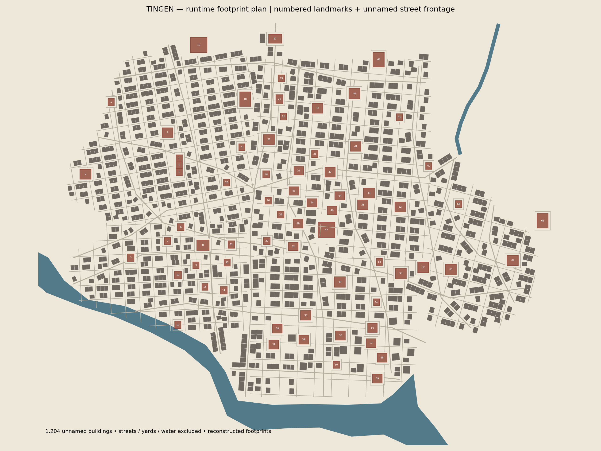
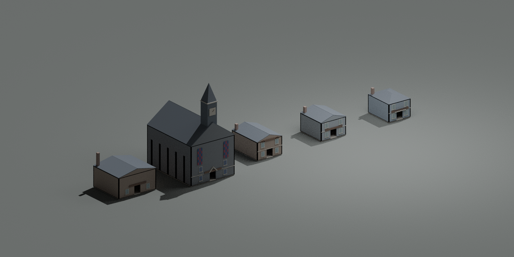

# Tingen city revision

Open `studio/Mysteries.rbxlx` in Studio and press **Play**. The server builds the city at runtime. This repository update does not publish a Roblox experience.

The map now includes **1,204 unnamed buildings**, in addition to all 67 reference entries and the approximate River and Sea Cathedral. Entry 5 produces three businesses in north-to-south order. Residential street fronts sit close together (median nearest parcel-edge gap about 1.2 studs), with larger clearances around estate, university and civic plots. The old isolated-landmark layout and long access spurs have been replaced by a connected-looking street network and local frontage lanes. Street connectivity in the Roblox engine still needs play-testing.

North is negative Z; Civic Square is the origin. Landmark coordinates come from the supplied photograph. Unnamed parcel footprints, secondary streets and architectural dimensions are reconstructed, not precise canon measurements. See [source decisions and limits](TINGEN_SOURCES.md).

The diagram is generated from the same data used by the game. It shows building footprints and street spacing, not a separate illustrative layout.

This is an offline Blender render of native-part geometry emitted by the actual architecture module through a math/Instance adapter. It is not a Studio screenshot. From left: industrial shell, Saint Selena, Blackthorn, old lodging, Daffodil terrace. Roblox materials, lighting and signage require Studio review.

Known landmarks have open entrances and simplified interiors; unnamed infill has solid exterior shells. Daffodil has gray-blue walls and a hipped roof. Saint Selena has a steep roof, central dark clock tower and colored windows. Blackthorn uses an earlier-style façade and upper-floor reception. Other landmarks use differentiated building classes, not fully researched individual replicas. Full room plans, exact ornament and basement passages remain incomplete.

Four gameplay services remain around Civic Square; eighteen enemy spawns retain their tiers in reserved southern yards. These are gameplay additions. River surfaces are noncolliding above shallow riverbeds, with bank ground omitted over water. They do not implement swimming Terrain.

Streaming is enabled (128-stud minimum / 512-stud target). The builder yields after batches of 100 infill buildings. No per-house light sources are added. The higher part count still requires real device profiling.

Validation: parcel generation checks all infill against roads, water, landmarks, service plots and other parcels. Tests build the runtime map under engine stand-ins and check all landmark IDs, building count, service prompts, bounds and selected documented features. Luau compilation, strict API/type analysis, Rojo build and exact source-to-place verification also run. Studio navigation, physics, rendering, multiplayer and measured performance are not certified by these checks.

Regenerate layout with `python scripts/map/generate_tingen.py` (Shapely, Matplotlib). Reproduce the architecture review with `python scripts/map/preview_architecture.py` (Luau, Blender). Run `python scripts/check.py` for the project checks. Metrics are saved in `TINGEN_METRICS.json`.
